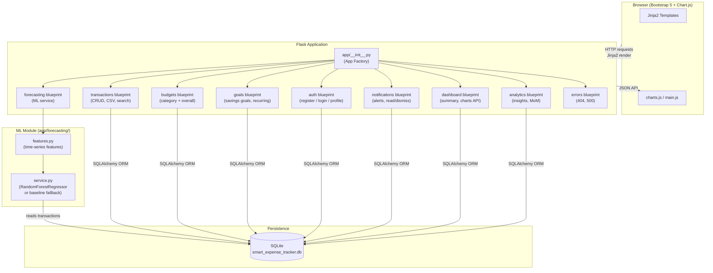
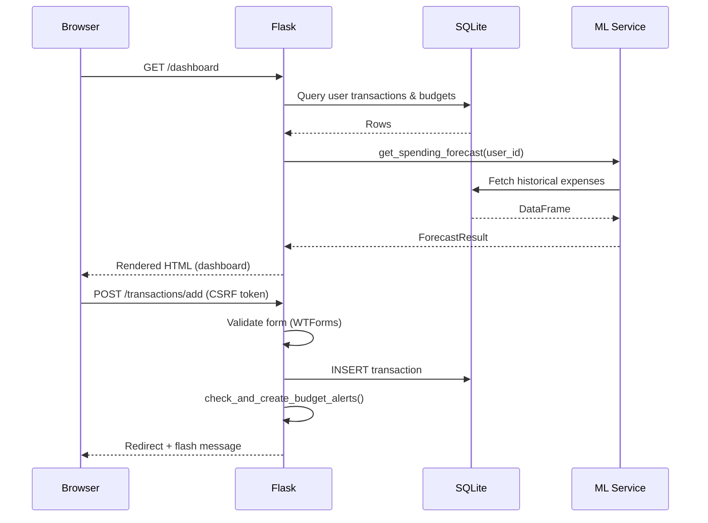
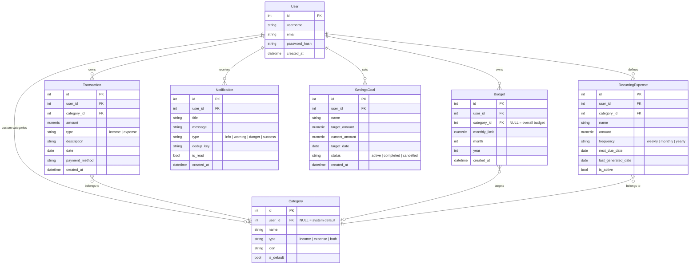
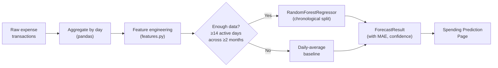

# Smart Expense Tracker with Spending Predictions

> A professional, full-stack personal finance web application built with Flask, SQLite, scikit-learn, and Bootstrap 5.

---

## Table of Contents

1. [Project Overview](#project-overview)
2. [Problem Statement and Objectives](#problem-statement-and-objectives)
3. [Technology Stack](#technology-stack)
4. [Architecture Overview](#architecture-overview)
5. [Database Schema](#database-schema)
6. [Feature Highlights](#feature-highlights)
7. [Machine Learning Forecasting](#machine-learning-forecasting)
8. [Installation — Windows (PowerShell)](#installation--windows-powershell)
9. [Installation — Linux / macOS](#installation--linux--macos)
10. [Running the Application](#running-the-application)
11. [Demo Data](#demo-data)
12. [Running Tests](#running-tests)
13. [Project Structure](#project-structure)
14. [Security Model](#security-model)
15. [Limitations and Future Enhancements](#limitations-and-future-enhancements)
16. [Troubleshooting](#troubleshooting)

---

## Project Overview

**Smart Expense Tracker with Spending Predictions** is an intermediate-to-advanced individual web project that helps users:

- Record and manage income and expense transactions
- Set and monitor monthly category budgets
- Forecast end-of-month spending using a trained Random Forest regressor
- Visualise spending behaviour through interactive Chart.js dashboards
- Receive in-app notifications when budgets are at risk
- Track savings goals and manage recurring expenses

This project demonstrates end-to-end software engineering skills — backend, frontend, database design, machine learning integration, security hardening, and automated testing — making it suitable as a final-year AIML/CS portfolio project.

---

## Problem Statement and Objectives

### Problem
Most personal finance apps either require expensive subscriptions, lack ML-driven insights, or do not protect user data properly. Students and early-career professionals need a self-hosted tool that is transparent about how its predictions work.

### Objectives

| # | Objective |
|---|-----------|
| 1 | Provide a secure multi-user expense tracking platform |
| 2 | Enable full CRUD over income/expense transactions |
| 3 | Support category-level and overall monthly budget management |
| 4 | Forecast end-of-month spending with a real ML model |
| 5 | Generate data-driven insights and budget-threshold alerts |
| 6 | Offer a clean, mobile-friendly Bootstrap 5 interface |
| 7 | Maintain a well-tested, well-documented codebase |

---

## Technology Stack

| Layer | Technology |
|-------|-----------|
| **Backend** | Python 3.11+, Flask 3.x |
| **ORM / DB** | Flask-SQLAlchemy 3.x, SQLite |
| **Auth** | Flask-Login, Werkzeug password hashing |
| **Forms** | Flask-WTF + WTForms (CSRF protection built-in) |
| **Migrations** | Flask-Migrate (Alembic) |
| **ML / Data** | scikit-learn, pandas, NumPy, joblib |
| **Frontend** | HTML5, CSS3, Bootstrap 5.3, Jinja2 |
| **Charts** | Chart.js 4.x |
| **Testing** | pytest, Flask test client |
| **Config** | python-dotenv, .env file |

---

## Architecture Overview



### Request Lifecycle



---

## Database Schema



---

## Feature Highlights

### User Authentication & Security
- Bcrypt-based password hashing via Werkzeug
- Session-based login with Flask-Login
- CSRF tokens on every state-changing form (Flask-WTF)
- All queries scoped to `current_user.id` — users can never access another user's data by manipulating URL parameters
- Environment-variable-based secret key; dev-only fallback documented, never used in production
- SQL injection prevention via SQLAlchemy ORM — no raw string queries

### Transaction Management
- Full CRUD for income and expense transactions
- Filter by date range, category, type, and payment method
- Search by description (case-insensitive LIKE)
- Sort by date or amount (ascending / descending)
- Server-side pagination (15 records per page by default)
- CSV export of filtered results (authenticated user only)
- User-specific custom categories in addition to 14 built-in defaults

### Dashboard
Six summary cards updated in real time from the database:

| Card | Calculation |
|------|------------|
| Total Income | Sum of income transactions in selected period |
| Total Expenses | Sum of expense transactions in selected period |
| Balance | Income − Expenses *(simplified cash-flow, not net worth)* |
| Savings Rate | (Income − Expenses) / Income × 100 |
| Budget Utilisation | Actual spend / Overall budget limit × 100 |
| Predicted Month-End | ML forecast total (or baseline if data is sparse) |

Five Chart.js charts:
- Income vs. Expenses by month (bar)
- Expense breakdown by category (doughnut)
- Daily spending trend (line)
- Monthly spending comparison (bar)
- Budget vs. Actual by category (horizontal bar)

### Budget Management
- Overall monthly budget + per-category monthly budgets
- Duplicate prevention per user/category/month
- Colour-coded progress bars (green → orange → red)
- Automated alerts at 50 % / 80 % / 100 % with deduplication (`dedup_key` unique constraint)
- Alerts recalculated on each transaction change, not on every page load

### Spending Prediction (ML)
See the [Machine Learning Forecasting](#machine-learning-forecasting) section below.

### Savings Goals & Recurring Expenses
- Savings goals with target amount, target date, and progress tracking
- Manual deposits toward a goal with automatic completion detection
- Recurring expense templates (weekly / monthly / yearly)
- Idempotent transaction generation: running the processor twice never creates duplicate transactions
- No background daemon required; templates are processed on-demand when the Goals page is visited

### Notifications
- In-app notification centre with unread count badge
- Notifications for: budget threshold hits, overspending forecasts, goal milestones
- Read / dismiss support
- Deduplicated by `dedup_key` unique per user

---

## Machine Learning Forecasting

### Goal
Predict the user's total expenses by the end of the current month and estimate remaining daily spending.

### Pipeline



### Features Used

| Feature | Description |
|---------|-------------|
| `day_of_week` | 0 = Monday … 6 = Sunday |
| `day_of_month` | 1–31 |
| `month` | 1–12 |
| `is_weekend` | Binary flag |
| `rolling_7d_avg` | 7-day rolling mean of daily spend (lagged by 1 to prevent leakage) |
| `rolling_30d_avg` | 30-day rolling mean (lagged by 1) |
| `lag_1` | Yesterday's daily spend |
| `lag_7` | Same weekday last week |

### Anti-Leakage Guarantees
- Rolling averages are shifted by 1 day before feature construction — the model never sees today's spend when predicting today.
- Chronological train/validation split: the most recent 30 % of months are used for validation, the rest for training.
- Income transactions are never included in expense forecasting.
- Transactions from other users are never included.

### Fallback Behaviour
When fewer than 14 historical spending days are available:

> The page clearly states **"Baseline Estimate (insufficient data for ML model)"** and uses a simple 7-day rolling average instead.

Accuracy metrics and confidence ranges are only displayed when the ML model has been trained — never fabricated.

### Forecast Output
1. Expenses recorded so far this month
2. Forecast expenses for remaining days
3. Predicted month-end total
4. Current daily spending pace
5. Historical monthly comparison table
6. MAE and percentage error (when validation data exists)
7. Explanation of the estimation method
8. Warning banner when data is sparse

---

## Installation — Windows (PowerShell)

### Prerequisites
- Python 3.11 or later — verify with `python --version`
- Git (optional, for cloning)

```powershell
# 1. Navigate to the project directory
cd C:\Users\nsudh\.gemini\antigravity\scratch\smart_expense_tracker

# 2. Create a virtual environment
python -m venv .venv

# 3. Activate the virtual environment
.venv\Scripts\Activate.ps1

# 4. Install dependencies
pip install -r requirements.txt

# 5. Copy the environment file and (optionally) set a strong SECRET_KEY
Copy-Item .env.example .env
# Edit .env with your preferred text editor:
# notepad .env

# 6. Initialise the database
python run.py init-db

# 7. (Optional) Seed 120 days of demo data
python seed.py

# 8. Start the development server
python run.py
```

Open your browser at **http://127.0.0.1:5000**

### PowerShell Execution Policy Note
If `Activate.ps1` is blocked, run once as Administrator:
```powershell
Set-ExecutionPolicy -ExecutionPolicy RemoteSigned -Scope CurrentUser
```

---

## Installation — Linux / macOS

### Prerequisites
- Python 3.11+ — `python3 --version`
- pip

```bash
# 1. Enter the project directory
cd /path/to/smart_expense_tracker

# 2. Create a virtual environment
python3 -m venv .venv

# 3. Activate the virtual environment
source .venv/bin/activate

# 4. Install dependencies
pip install -r requirements.txt

# 5. Set up the .env file
cp .env.example .env
# Edit .env if desired: nano .env

# 6. Initialise the database
python run.py init-db

# 7. (Optional) Seed demo data
python seed.py

# 8. Start the server
python run.py
```

---

## Running the Application

```powershell
# Windows — activate venv first
.venv\Scripts\Activate.ps1
python run.py
```

```bash
# Linux / macOS — activate venv first
source .venv/bin/activate
python run.py
```

The server starts at **http://127.0.0.1:5000** in debug mode.

> **Production note:** Set `FLASK_ENV=production` and `DEBUG=False` in `.env` before deploying. Use a production WSGI server such as Gunicorn or Waitress — never use Flask's built-in server in production.

---

## Demo Data

The `seed.py` script creates a demo account with 120 days of realistic synthetic data:

| Field | Value |
|-------|-------|
| Email | `demo@smarttracker.com` |
| Password | `password123` |
| Transactions | ~193 (income + expenses across 14 categories) |
| ML status | RandomForestRegressor trained and active |

```powershell
python seed.py
```

Running `seed.py` again detects the existing demo account and skips re-seeding to prevent duplicates.

---

## Running Tests

```powershell
# Windows
.venv\Scripts\Activate.ps1
python -m pytest tests/ -v
```

```bash
# Linux / macOS
source .venv/bin/activate
python -m pytest tests/ -v
```

### Test Suite — 26 Tests

| Module | Tests | What Is Covered |
|--------|-------|----------------|
| `test_auth.py` | 6 | Registration, duplicate email, password mismatch, login, logout, password hashing |
| `test_authorization.py` | 4 | IDOR prevention — user A cannot read/edit/delete user B's transactions, budgets, goals |
| `test_budgets.py` | 3 | Create overall budget, duplicate prevention, threshold alerts with deduplication |
| `test_forecasting.py` | 4 | Anti-leakage features, sparse fallback, ML with adequate history, income exclusion |
| `test_recurring_and_goals.py` | 2 | Idempotent recurring generation, goal completion and milestone notification |
| `test_transactions.py` | 7 | Add expense/income, negative amount rejection, edit, delete, search/filter, CSV export |

**Result: 26 passed, 0 failed**

---

## Project Structure

```
smart_expense_tracker/
├── app/
│   ├── __init__.py          # Flask app factory
│   ├── extensions.py        # db, login_manager, csrf
│   ├── models.py            # SQLAlchemy models (7 tables)
│   ├── utils.py             # Shared helpers, alert generation
│   ├── auth/                # Blueprint: register, login, profile
│   ├── transactions/        # Blueprint: CRUD, CSV, search, filter
│   ├── budgets/             # Blueprint: overall + category budgets
│   ├── forecasting/         # Blueprint + ML module
│   │   ├── features.py      # Time-series feature engineering
│   │   ├── service.py       # RandomForestRegressor / baseline
│   │   └── routes.py
│   ├── analytics/           # Blueprint: insights, MoM, breakdown
│   ├── goals/               # Blueprint: savings goals, recurring
│   ├── notifications/       # Blueprint: notification centre
│   ├── dashboard/           # Blueprint: summary + charts JSON API
│   ├── errors/              # 404 / 500 handlers
│   ├── static/
│   │   ├── css/style.css    # Fintech UI design system
│   │   └── js/
│   │       ├── main.js      # Sidebar toggle, UX helpers
│   │       └── charts.js    # All Chart.js renderers
│   └── templates/           # Jinja2 HTML templates (17 files)
├── tests/
│   ├── conftest.py          # Fixtures: app, client, users, categories
│   ├── test_auth.py
│   ├── test_authorization.py
│   ├── test_budgets.py
│   ├── test_forecasting.py
│   ├── test_recurring_and_goals.py
│   └── test_transactions.py
├── instance/                # SQLite DB lives here (git-ignored)
├── config.py                # Dev / Test / Production configs
├── run.py                   # Entry point + init-db CLI command
├── seed.py                  # Demo data generator
├── requirements.txt
├── .env.example
├── .gitignore
├── setup.cfg                # pytest configuration
└── README.md
```

---

## Security Model

| Threat | Mitigation |
|--------|-----------|
| SQL injection | SQLAlchemy ORM — no raw string queries |
| CSRF | Flask-WTF tokens on every state-changing form |
| IDOR (Insecure Direct Object Reference) | All queries include `filter_by(user_id=current_user.id)` |
| Password storage | Werkzeug `generate_password_hash` (pbkdf2:sha256) |
| Session hijacking | Flask secret key via environment variable; HTTPS in production |
| Sensitive config leakage | `.env` is git-ignored; `.env.example` ships instead |
| Dev secret key | `config.py` fallback key is labelled **dev-only** — never use in production |

> **Important:** The development secret key in `config.py` (`"dev-secret-key-change-in-production"`) is intentionally weak and documented as a dev-only fallback. Always set a strong, random `SECRET_KEY` in your `.env` file for any non-local deployment.

---

## Limitations and Future Enhancements

### Current Limitations

- **SQLite only:** Not suitable for high-concurrency production environments; switch to PostgreSQL or MySQL for multi-user deployments.
- **No email verification:** User registration does not verify email addresses.
- **No 2FA:** Single-factor authentication only.
- **Local ML only:** The forecast model is trained and run in-process; no model persistence between restarts (intentional design choice for simplicity).
- **Balance calculation:** The dashboard balance card shows a simplified cash-flow figure (Income − Expenses). It is explicitly **not** a measure of net worth.
- **Savings rate:** Calculated as `(Income − Expenses) / Income × 100`. Shows 0 % when income is zero to avoid division-by-zero. This is a simplified metric.
- **No real-time updates:** Dashboard data requires a page refresh; no WebSocket or SSE push.

### Suggested Future Enhancements

| Enhancement | Complexity |
|-------------|-----------|
| PostgreSQL support | Low — change `SQLALCHEMY_DATABASE_URI` |
| Email alerts for budget overruns | Medium — add Flask-Mail |
| OCR receipt scanning | High — integrate Tesseract or a cloud OCR API |
| Bank statement import (OFX / CSV) | Medium |
| Multi-currency support | Medium |
| LSTM / Prophet time-series model | High — better long-range forecasts |
| PWA / offline mode | High |
| REST API + mobile app | High |
| Two-factor authentication (TOTP) | Medium — Flask-TOTP or PyOTP |

---

## Troubleshooting

### `ModuleNotFoundError` on startup
Ensure the virtual environment is activated:
```powershell
.venv\Scripts\Activate.ps1   # Windows
source .venv/bin/activate    # Linux / macOS
```

### `CSRF token missing or incorrect`
This usually means you are sending a POST request without the hidden `{{ form.hidden_tag() }}` field. All forms in the templates already include it. If you are testing with curl or Postman, disable WTF in the Testing config (already done in `config.py`).

### `sqlalchemy.exc.OperationalError: no such table`
Run the database initialisation command:
```powershell
python run.py init-db
```

### Forecast page shows "Insufficient data"
The ML model requires at least 14 days of expense history across 2 or more months. Run `python seed.py` to generate demo data, or record expenses for several weeks.

### `Activate.ps1 cannot be loaded` on Windows
```powershell
Set-ExecutionPolicy -ExecutionPolicy RemoteSigned -Scope CurrentUser
```

### Port 5000 already in use
```powershell
# Windows: find and kill the process using port 5000
netstat -ano | findstr :5000
taskkill /PID <PID> /F
```

### Tests fail with `ImportError`
Ensure you are running pytest from the project root with the venv active:
```powershell
python -m pytest tests/ -v
```
Do not use a bare `pytest` command if it resolves to a different Python installation.

---

## Acknowledgements

This project was built as an individual portfolio project demonstrating full-stack development, machine learning integration, and software engineering best practices. It uses only open-source libraries and requires no paid APIs or external services.

---

*Smart Expense Tracker with Spending Predictions — Built with Flask, scikit-learn, and Bootstrap 5.*
